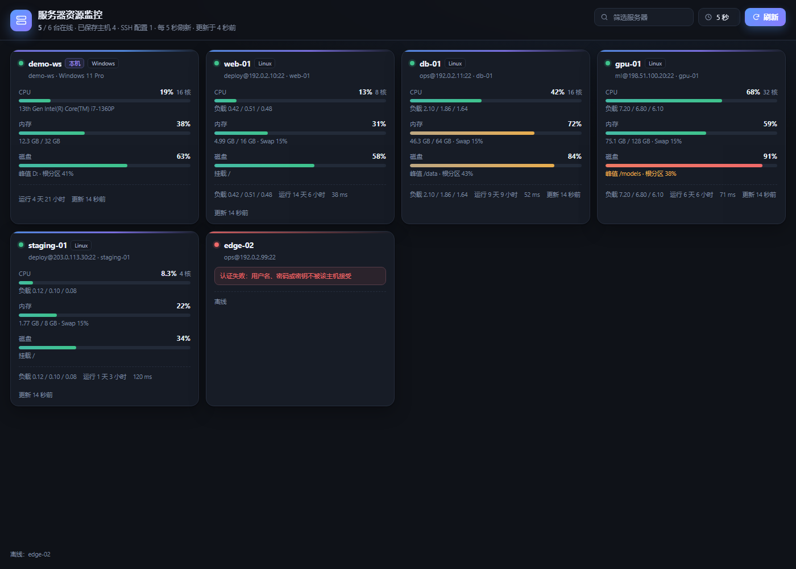

# dsh-server-monitor

在 DeepSeek Harness 里一眼看完 **本机 + 所有远程服务器** 的 CPU、内存、磁盘占用。

- 会话区顶部新增「服务器资源」标签页，右侧栏也可以打开同一个面板。
- 数据来源自动合并：`dsh-remote` 已保存的 SSH 主机 + `~/.ssh/config` 里的主机 + 本机。
- 每台服务器一张卡片：CPU、内存、磁盘（取占用最高的挂载点，并显示根分区）、负载、运行时间、SSH 延迟，以及最近 40 次 CPU 采样的迷你曲线。
- 默认 5 秒刷新，可切换 3/5/10/30 秒或手动刷新；页面隐藏时暂停轮询。
- 离线/认证失败/超时的服务器会显示具体原因，不会拖慢其它卡片。
- 以标准 DSH bundle 形式安装：设置 → 插件 里有图标、版本、描述，可启用/禁用/卸载。

> **同名说明**：本项目与 [`ZhaoZiyangShaanxi/dsh-server-monitor`](https://github.com/ZhaoZiyangShaanxi/dsh-server-monitor) **不是同一个插件**。后者做容器 / QQ 登录 / noVNC 监控；本项目只做本机与 SSH 服务器的 CPU、内存、磁盘。
>
> 仓库：<https://github.com/xua123/dsh-server-monitor>



## 安装

### 方式一：从 GitHub 安装（推荐）

在 DSH 里打开 **设置 → 插件 → 安装**，输入仓库地址：

```
https://github.com/xua123/dsh-server-monitor
```

或者从 [Releases](https://github.com/xua123/dsh-server-monitor/releases) 下载 `dsh-server-monitor-0.1.4.tgz`，用“本地文件”安装。

### 方式二：本地打包

1. 生成安装包：

   ```powershell
   cd path\to\dsh-server-monitor
   npm run pack
   ```

   产物：`dist/dsh-server-monitor-0.1.4.tgz`

2. 打开 DeepSeek Harness → **设置 → 插件** → 安装插件 → 选择本地文件，选中上面的 `.tgz`。
3. 插件页会出现 `dsh-server-monitor`，保持启用；刷新页面，聊天区顶部就会出现「服务器资源」标签页。

也可以从命令行安装（注意：CLI 只做 `pnpm add`，不会自动把包加入 `dsh.profile.bundles`）：

```powershell
dsh plugin --profile desktop add file:/absolute/path/to/dist/dsh-server-monitor-0.1.4.tgz --prefer-offline --ignore-scripts
```

然后把 `dsh-server-monitor` 追加到 profile `package.json` 的 `dsh.profile.bundles` 数组，重启 DSH。

> 不要用“目录联接（junction）”把 `node_modules` 指向源码目录。pnpm 替换 `link:` 依赖时可能跟随联接删除目标目录内容；请始终用 `.tgz` 或插件页安装。

## 服务器从哪来

| 来源 | 路径 | 说明 |
| --- | --- | --- |
| 本机 | — | Node `os` + `fs.statfs`，Windows/Linux/macOS |
| dsh-remote 已保存主机 | `~/.dsh/remote-workspaces/machines.json` | 直接复用已保存的密码 / 密钥 / 端口 |
| OpenSSH 配置 | `~/.ssh/config` | 只读取具体的 `Host` 块；不使用 `Host *` 默认值，也不处理 `ProxyJump` |

同一台机器（host + port 相同）只显示一张卡片；如果同一 IP 下存了 root、deploy 等多个账号，会优先使用带密码/密钥的那条记录。`machines.json` 里 `host` 字段被误写成显示名的坏记录会被跳过。

## 配置

在 profile 的 `cordis.yml` / `cordis.patch.yml` 里给这一行加 `config`：

```yaml
- id: dsh-server-monitor
  name: dsh-server-monitor
  config:
    refreshMs: 5000          # 建议的浏览器刷新间隔
    cacheMs: 2500            # 服务端复用一次采集结果的时长
    errorCacheMs: 15000      # 失败主机的重试间隔
    waitMs: 2500             # 单次请求最多等多久，超时先返回“采集中”
    maxConcurrent: 6         # 同时拨号的 SSH 主机数
    commandTimeoutMs: 12000  # 单条远程命令超时
    connectTimeoutMs: 8000   # SSH 握手超时
    idleCloseMs: 120000      # 空闲连接回收时间
    includeSavedMachines: true
    includeSshConfig: true
    machinesFile: ''         # 覆盖 machines.json 路径
    sshConfigFile: ''        # 覆盖 ~/.ssh/config 路径
    ignoreHosts: ['192.0.2.99', 'old-*']  # 支持 * 和 ?
    hostKeyPolicy: tofu      # tofu | off
    showLocal: true
```

## 数据与安全

- 远程只执行一条 **只读** POSIX 命令（`hostname`、`/proc/stat`、`/proc/meminfo`、`df`），不写文件、不调用 sudo。
- `machines.json` 里的密码只存在于 Host 进程内存和 ssh2 的连接参数里；浏览器拿到的 JSON 不含 `password` / `passphrase` / 私钥路径。
- 主机密钥采用 **首次信任（TOFU）**：第一次连接时把 SHA-256 指纹写到 `~/.dsh/server-monitor/known-hosts.json`，之后指纹变化会拒绝连接。确认安全后可删除该文件重新记录，或把 `hostKeyPolicy` 设为 `off`。
- 采集接口是回环地址上的只读 GET，不提供任何修改服务器的能力。
- 页面不引入外部脚本、字体或 CDN。

## 目前不支持

- 远程 **Windows / macOS** 主机（Linux 之外会返回「暂不支持」）；本机支持三个平台。
- `~/.ssh/config` 里的 `ProxyJump` / `ProxyCommand`、Kerberos/GSSAPI 主机。
- 磁盘只统计真实文件系统；`tmpfs`、`overlay`、`squashfs` 等会被过滤掉。

## 打包与分发

```powershell
npm run pack
```

只把 `lib/`、`assets/`、`cordis.patch.yml`、`icon.svg`、`README.md` 和 `package.json` 打进 `.tgz`，`node_modules` 与源码外的文件不会进入包。对方用插件页安装同一个 `.tgz` 即可。

## 排错

| 现象 | 原因 / 处理 |
| --- | --- |
| 插件页看不到 | 确认 `.tgz` 安装成功，且 `dsh-server-monitor` 在 profile 的 `dsh.profile.bundles` 里；重启 DSH |
| 卡片显示「认证失败」 | 该主机在 `machines.json` 里没有密码，`~/.ssh` 的默认密钥也没被授权；在 dsh-remote 里补密码或配置密钥 |
| 一直「采集中」 | 主机在 `connectTimeoutMs` 内没完成 SSH 握手；首次连接多等一轮刷新即可 |
| 「主机密钥已变化」 | 服务器重装或换钥；确认安全后删除 `~/.dsh/server-monitor/known-hosts.json` 里对应条目 |
| 页面 404 | Host 插件没加载成功；检查重启后插件页里该插件是否启用 |
| 依赖 `dist/*.tgz` 丢失 | 重新 `npm run pack`，再用插件页或 `dsh plugin add` 安装新包 |

## 目录

```
lib/index.js          Host 插件：快照缓存、并发拨号、HTTP 路由
lib/machines.js       合并 dsh-remote 注册表与 ~/.ssh/config
lib/ssh.js            SSH 连接池、主机密钥 TOFU、错误分类
lib/collect-local.js  本机 CPU / 内存 / 磁盘
lib/collect-remote.js Linux 远程采集脚本与解析
lib/client.js         浏览器半侧：会话标签页 + 右侧栏 iframe
assets/dashboard.html 仪表盘页面（零依赖 HTML/CSS/JS）
icon.svg              插件页图标
cordis.patch.yml      标准 DSH bundle patch
```
