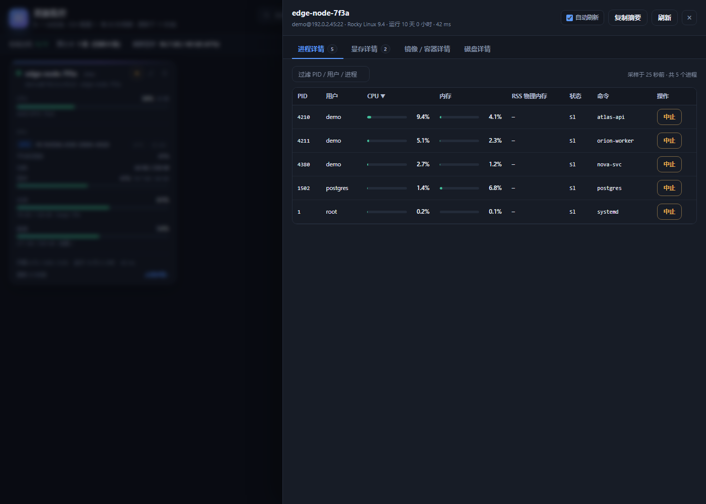
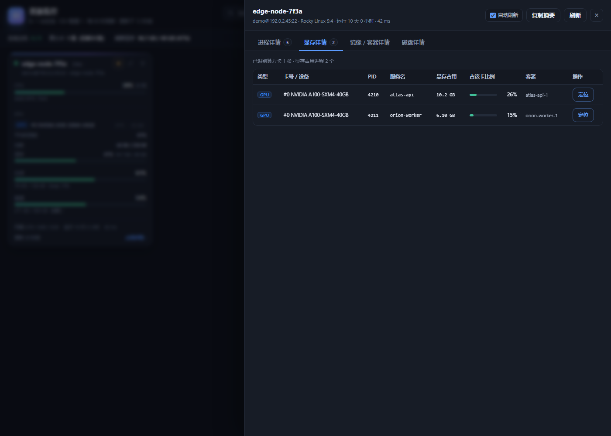
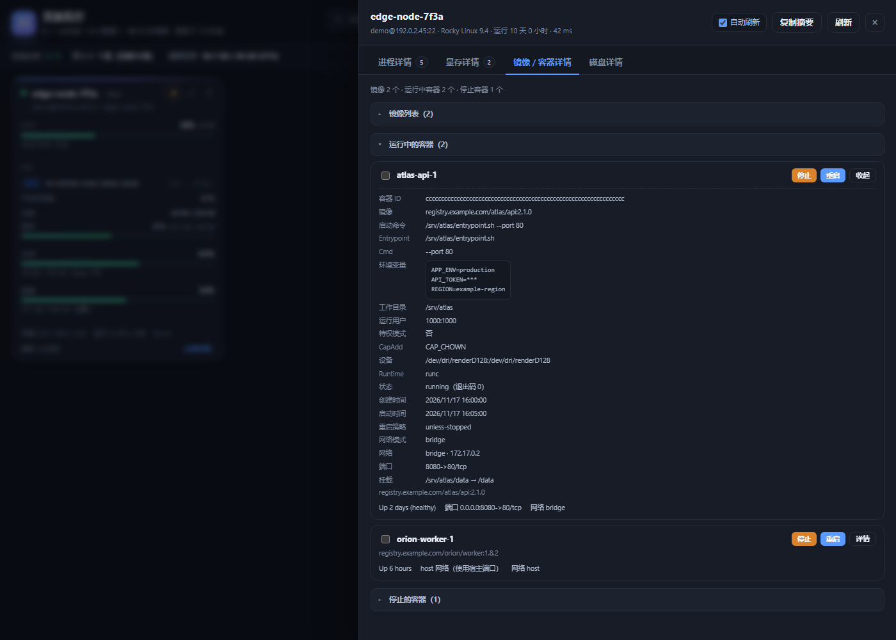

# dsh-server-monitor

A server resource monitor for [DeepSeek Harness](https://github.com/deepseek-ai/deepseek-harness). It shows local and SSH server usage in the DSH sidebar and in a per-session tab.


[中文说明](#中文说明)

## Features

- **Host resources** — CPU, memory, swap, disk mounts, network throughput, load average, uptime and SSH latency.
- **Accelerators** — per-card utilization, memory, temperature and power for NVIDIA GPU, Huawei Ascend NPU and Hygon DCU.
- **Processes** — sortable process table, process search, and confirmed `SIGTERM` termination with a `SIGKILL` fallback.
- **Docker** — image and container lists, start/stop/restart/delete, multi-select deletion, startup parameters, and an image-to-container dependency tree.
- **Two scopes** — a global server panel and a session-scoped server tab that follows the current workspace.
- **Read-only collection** — resource samples use read-only commands; credentials stay on the local machine.

## Install

### GitHub

1. Open **Settings → Plugins → Install**.
2. Enter:

```text
https://github.com/xua123/dsh-server-monitor
```

3. Quit DSH completely, then start it again.

### GitHub Release tarball

```text
https://github.com/xua123/dsh-server-monitor/releases/download/v0.2.0/dsh-server-monitor-0.2.0.tgz
```

The URL is pinned to `v0.2.0`, so the asset name can safely contain the version.

Requirements: DSH `>= 0.2.1-rc.1`, Node `>= 20`.

## Usage

### Global panel

Click the server icon in the left sidebar. The panel lists:

- the local machine;
- hosts discovered from `~/.ssh/config`;
- hosts added manually in the panel.

It supports search, tag filters, card/list views, and sorting by remaining accelerator memory, CPU, memory or average utilization.

### Session tab

Open the **资源监控** tab in a conversation. The tab reads the session workspace and shows the matching server only. If no server can be matched, choose one from the selector in the tab header.

## Resource coverage

| Area | Data |
| --- | --- |
| CPU | usage, cores, model, 1/5/15-minute load |
| Memory | used/total, percentage, swap |
| Disk | root and mounted filesystems, used/total, busiest mount |
| Network | receive/transmit rate |
| System | hostname, OS, kernel, uptime, SSH latency |
| GPU | utilization, memory, temperature, power, compute capability |
| NPU | AICore utilization, memory, temperature, power; Ascend 310P/910B compatible |
| DCU | utilization, VRAM, temperature, power; `hy-smi` JSON/table compatible |
| Containers | CPU/memory limits when running inside a container |

### Process details



### Accelerator memory



## Process and Docker operations

Process termination and Docker mutations require the page token and a confirmation dialog.

- A process can only be terminated if its PID is present in the current detail view.
- `SIGTERM` is sent first; if the process remains, a separate **强制杀死（SIGKILL）** action is offered.
- Container start, stop, restart and delete are confirmed.
- Image deletion reports the containers that still reference the image.
- Running containers must be stopped before they can be deleted.

### Container details



## Security and privacy

- Resource collection uses read-only commands such as `/proc`, `df`, `nvidia-smi`, `npu-smi` and `hy-smi`.
- The plugin does not upload telemetry or resource data.
- Manually added passwords are stored locally in `~/.dsh/server-monitor/targets.json` with mode `0600`; use SSH keys where possible.
- Host visibility, aliases and selection state are stored locally under `~/.dsh/server-monitor/`.
- The repository contains no server addresses, credentials, private hostnames or customer data.

## Limitations

- Remote collection targets Linux; Windows is supported for the local host only.
- `ProxyJump` / `ProxyCommand` are not supported yet.
- DCGM exporter or Prometheus is not required.
- NPU/DCU power limits depend on the vendor tool; only actual power is shown when no limit is available.
- Session scoping depends on DSH session `cwd` metadata; use the manual selector when it cannot be resolved.

## Development

```bash
npm install
npm test
npm pack
```

## License

MIT

---

## 中文说明

在 DeepSeek Harness 中查看本机与 SSH 服务器资源，提供全局面板和会话页签两种入口。

### 功能

- **基础资源**：CPU、内存、Swap、磁盘、网络、负载、运行时间、SSH 延迟。
- **异构算力**：NVIDIA GPU / 华为昇腾 NPU / 海光 DCU 的利用率、显存、温度、功耗。
- **进程**：可搜索、排序的进程表；确认后发送 `SIGTERM`，失败可再确认发送 `SIGKILL`。
- **Docker**：镜像和容器列表、启停/重启/删除、批量删除、启动参数、镜像依赖树。
- **两种入口**：全局服务器面板；跟随当前会话工作区的服务器页签。
- **只读采集**：资源采样只执行只读命令，凭据保存在本地。

### 安装

```bash
dsh plugin --profile desktop add dsh-server-monitor
```

或在 **设置 → 插件 → 安装** 中填入：

```text
https://github.com/xua123/dsh-server-monitor
```

安装后完全退出 DSH（托盘 Quit）再启动。

### 使用

- 点击左侧栏服务器图标打开全局面板；
- 在会话中打开「资源监控」页签查看当前工作区服务器；
- 需要密码认证的服务器可在面板中手动添加。

### 安全

- 不上传遥测或资源数据；
- 手动添加的密码仅保存在本机 `~/.dsh/server-monitor/targets.json`（`0600`）；
- 仓库中不包含服务器地址、凭据、私有主机名或客户数据。

### 限制

- 远程采集面向 Linux，Windows 仅支持本机；
- 暂不支持 `ProxyJump` / `ProxyCommand`；
- NPU/DCU 功耗上限取决于厂商工具。
